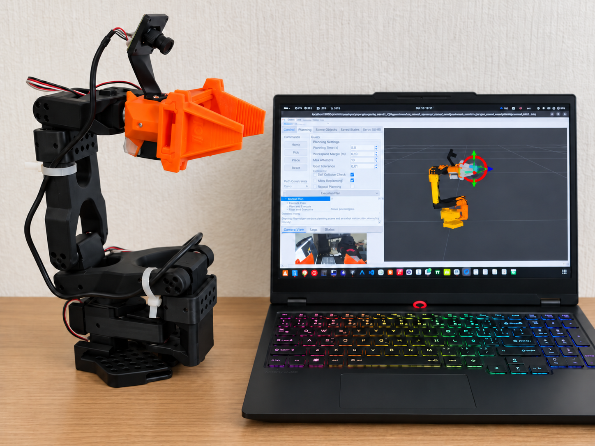

# SO-ARM101 pgripper

ROS 2 Jazzy workspace for an SO-ARM101 follower arm with a NormaCore pgripper.

The workspace provides:

- Five arm joints and one gripper motor
- Motor calibration and read-only RViz
- Mock and real MoveIt 2 planning with Pick IK
- MoveIt Servo with keyboard or PS4 input
- Gripper camera capture and intrinsic calibration.


*SO-ARM101 with the NormaCore pgripper and wrist-mounted camera.*

> [!WARNING]
> Start with a mock task. Real tasks can enable torque and move the arm.

## Install and build

Install Pixi on Linux x86_64.

Clone the repository:

```bash
git clone --recurse-submodules https://github.com/AtharvaBhorpe/so_arm101_pgripper.git
cd so_arm101_pgripper
```

For an existing clone without submodules, run:

```bash
git submodule update --init --recursive
```

Install the dependencies:

```bash
pixi install
```

Build and run the workspace tests:

```bash
pixi run build
pixi run test
```

The camera launch also requires system `v4l-utils`:

```bash
sudo apt install v4l-utils
```

## Start the mock robot

Start the robot model with joint sliders:

```bash
pixi run display
```

For mock planning, start MoveIt:

```bash
pixi run moveit-demo
```

Mock tasks do not open a motor serial port or enable torque.

In RViz:

1. Select the `arm` planning group.
2. Keep **Approx IK Solutions** active.
3. Move the tool marker to a small reachable pose.
4. Select **Plan**.
5. Examine the planned path.
6. Select **Execute**.

For gripper motion, select the `gripper` group.
Choose the `open` or `close` named state.

The arm has five degrees of freedom.
It cannot reach every position and orientation combination.

## Use the real robot

> [!WARNING]
> Support the arm. Keep the power connector accessible.
> Real motion tasks enable motor torque.
> If the arm moves unexpectedly, vibrates, or buzzes, stop the task.

### Read-only RViz

Run the read-only task before real motion:

```bash
pixi run real-rviz
```

The driver reads physical joint states without enabling torque.

1. Open the gripper jaws.
2. Make sure that RViz shows `0 rad` for `gripper`.
3. Move each joint by hand.
4. Make sure that RViz follows the same direction.

### MoveIt planning

If read-only RViz matches the physical arm, run:

```bash
pixi run moveit-real
```

Use **Plan** before execution.
Start with a small motion and low velocity and acceleration scales.

### MoveIt Servo

In terminal 1, start the real Servo task:

```bash
pixi run moveit-servo-real
```

When Servo reports that it is ready, start keyboard input in terminal 2:

```bash
pixi run servo-keyboard-input
```

Start with small single-joint motions.
Press Space to send a zero command.
Press `x` to exit the keyboard input.

The real tasks use `/dev/ttyACM0` by default.
Make sure that this device belongs to the robot.

If the device path changes, update the task in [pixi.toml](pixi.toml).

Read the [MoveIt and Servo guide](src/so_arm101_pgripper_moveit_config/README.md)
for input maps and operating limits.

## Calibrate the motors

> [!WARNING]
> Support the arm throughout calibration. Disabling torque can let the arm fall.
> Read the calibration procedure before an EEPROM write.

Run full calibration:

```bash
pixi run calibrate --port /dev/ttyACM0 \
  --robot-id so_arm101_pgripper_follower \
  --calibration-dir config/hardware
```

After full calibration, run the wrist-roll procedure:

```bash
pixi run calibrate --port /dev/ttyACM0 \
  --robot-id so_arm101_pgripper_follower \
  --calibration-dir config/hardware \
  --wrist-roll-only
```

The wrist-roll procedure measures its asymmetric physical stops.

The [description guide](src/so_arm101_pgripper_description/README.md)
contains the preparation, prompts, and required physical checks.

## Gripper camera

The connected device identifies as `Innomaker-U20CAM-720P`.
Hardware tests measured about 30 fps at 1280×720.

After the initial package build, start capture:

```bash
pixi run gripper-cam
```

This task does not rebuild the package automatically.
It does not control the arm's motors.

The launch loads intrinsic calibration from the installed camera package.
It publishes raw images and camera information.
Raw images still contain lens distortion.

Rectification is experimental and disabled by default.
Physical optical-frame alignment remains unverified.
Hand–eye calibration is not implemented.

Read the [camera guide](src/so_arm101_pgripper_cameras/README.md)
for calibration, device selection, and known limitations.

## Commands

| Command | Purpose | Motor action |
| --- | --- | --- |
| `pixi run build` | Build the workspace | Does not control physical motors |
| `pixi run test` | Run workspace tests | Does not control physical motors |
| `pixi run check` | Examine the generated URDF | Does not control physical motors |
| `pixi run display` | Show the model with joint sliders | Does not control physical motors |
| `pixi run moveit-demo` | Start mock MoveIt | Does not control physical motors |
| `pixi run moveit-servo-demo` | Start mock Servo | Does not control physical motors |
| `pixi run real-rviz` | Read physical joint states | Does not enable torque |
| `pixi run moveit-real` | Plan and execute real motion | Enables torque |
| `pixi run moveit-servo-real` | Start real Servo | Enables torque |
| `pixi run calibrate ...` | Calibrate the motors | Disables torque during calibration |
| `pixi run gripper-cam` | Start calibrated raw capture | Does not control physical motors |

Commands that do not control motors do not disable torque from another process.

## Workspace layout

| Path | Purpose |
| --- | --- |
| `src/so_arm101_pgripper_description` | URDF, Xacro, motor calibration, and RViz |
| `src/so_arm101_pgripper_hardware` | Local motor interface |
| `src/so_arm101_pgripper_moveit_config` | MoveIt, Servo, and input programs |
| `src/so_arm101_pgripper_cameras` | Camera launch, configuration, and intrinsic calibration |
| `config/hardware` | Machine-specific motor calibration and limits |
| `src/pick_ik` | Pinned upstream Pick IK |
| `src/feetech_ros2_driver` | Pinned upstream Feetech driver |
| `src/moveit_servo` | Pinned Servo fork with the five-joint fix |

## Guides and source records

- [Robot description and motor calibration](src/so_arm101_pgripper_description/README.md)
- [MoveIt and Servo](src/so_arm101_pgripper_moveit_config/README.md)
- [Camera capture and calibration](src/so_arm101_pgripper_cameras/README.md)
- [Pinned external sources](VENDORED.md)
- [Model attribution](src/so_arm101_pgripper_description/ATTRIBUTION.md)
