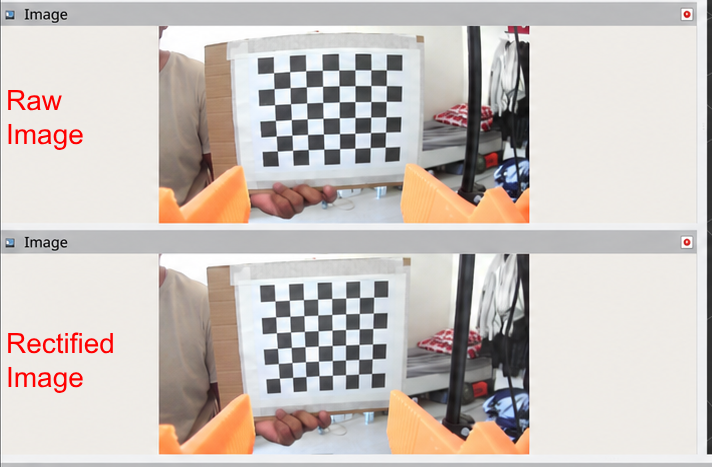

# SO-ARM101 cameras

This package configures the gripper camera and external UGREEN webcam through `usb_cam`.
It does not control motors or publish robot TF.

The connected device identifies as `Innomaker-U20CAM-720P`.
It advertises a maximum resolution of 1280×720.
The original hardware description named U20CAM-1080P.
The capture configuration follows the connected device.

The following capture and calibration procedures describe the gripper camera.
The External webcam section describes the UGREEN configuration.

## Start capture

Run these commands from the workspace root.

On Ubuntu, install the system camera utility:

```bash
sudo apt install v4l-utils
```

Install the Pixi dependencies:

```bash
pixi install
```

Build the camera package:

```bash
pixi run colcon build --symlink-install \
  --packages-select so_arm101_pgripper_cameras
```

Start the camera:

```bash
pixi run gripper-cam
```

To stop capture, press Ctrl+C.

The task uses the installed package.
It does not build the package automatically.

## Topics and frames

The default node is `/gripper_camera/usb_cam`.

| Topic | Content |
| --- | --- |
| `/gripper_camera/image_raw` | Color images with lens distortion |
| `/gripper_camera/camera_info` | Intrinsics, distortion coefficients, and projection matrix |

Image headers use `camera_optical_frame`.
The robot description defines its transform.
The camera driver does not publish TF.

In RViz, add an Image display.
Set its topic to `/gripper_camera/image_raw`.

A missing `map` frame does not prevent the Image display from showing pixels.

## Capture configuration

| Parameter | Value |
| --- | --- |
| Resolution | 1280×720 |
| Requested frame rate | 30.0 |
| Pixel format | `mjpeg2rgb` |
| Capture method | `mmap` |
| Camera name | `gripper_camera` |

Before capture, launch sets `exposure_dynamic_framerate=0`.
Automatic exposure previously reduced capture to about 15 fps.
Disabling dynamic frame rate restored about 30 fps.

If the control command fails or exceeds 10 seconds, launch stops.
This startup procedure is specific to the tested camera.

## Device selection

The default device identity is:

```text
/dev/v4l/by-id/usb-Innomaker_Innomaker-U20CAM-720P_SN0001-video-index0
```

Launch resolves this symlink before it passes the path to `usb_cam`.
The tested driver mishandled the relative symlink target.
The resolved `/dev/videoN` number can change after a reconnect or restart.

To override the device, identify its current path:

```bash
v4l2-ctl --list-devices
```

Then supply the path:

```bash
pixi run bash -c 'source install/setup.bash && ros2 launch so_arm101_pgripper_cameras gripper_camera.launch.py video_device:=/dev/video6'
```

The example uses `/dev/video6`, not a fixed assignment.
A device override does not select another calibration file.
A different camera requires its own calibration and compatible controls.

## Intrinsic calibration

Launch loads `config/gripper_camera_calibration.yaml` from the installed package.
It does not use the calibration file in `~/.ros/camera_info/`.

| Property | Value |
| --- | --- |
| Image size | 1280×720 |
| Model | Pinhole with `plumb_bob` distortion |
| Checkerboard | 8×6 inner corners |
| Square side | 0.025 m |
| Captured samples | 67 |

Live straightness error reached about 0.27–0.29 pixels in held views.
This is not an overall reprojection error or a guarantee of 3D accuracy.

The calibration applies to this camera, lens focus, and image mode.
Changes to those conditions require another calibration or accuracy assessment.

Intrinsic calibration does not determine the camera-to-gripper transform.
The URDF optical-center offset remains approximate.
Physical optical-frame alignment remains unverified.
Hand–eye calibration is not implemented.

### Prepare for calibration

COMMIT writes to the driver's configured calibration URL.
With a symlink install, this can overwrite the source calibration file.

1. Back up the current calibration file.
2. Keep the robot stationary.
3. Mount the checkerboard flat on rigid backing.
4. Use diffuse light without glare or strong shadows.
5. Set the lens focus before sample collection.
6. Start the camera with `pixi run gripper-cam`.

### Collect samples

In another terminal, start the calibrator:

```bash
pixi run ros2 run camera_calibration cameracalibrator \
  --size 8x6 \
  --square 0.025 \
  --camera_name gripper_camera \
  --ros-args \
  -r image:=/gripper_camera/image_raw \
  -r camera/set_camera_info:=/gripper_camera/usb_cam/set_camera_info
```

1. Move the board through different positions, distances, and tilts.
2. Pause at each position.
3. Keep all inner corners visible and sharp.
4. Collect samples until the X, Y, Size, and Skew bars show sufficient coverage.
5. Click CALIBRATE.
6. Examine the result with the board stationary at several image positions.

Green coverage bars do not establish calibration accuracy.

### Save and reload

1. Click SAVE to export the calibration and sample images.
2. Copy the archive from the reported path to durable storage outside Git.
3. Click COMMIT to send the calibration to the driver.
4. Examine the published calibration:

```bash
pixi run ros2 topic echo /gripper_camera/camera_info --once
```

5. Restart the camera.
6. Run the command again.
7. Make sure that the values match the saved file.

COMMIT calls `set_camera_info`. It is not a Git operation.

The tested calibrator reported a shutdown exception after COMMIT.
The driver still saved and published the calibration.
The file and published values determine whether saving succeeded.

Sample archives can contain private images.
Keep them outside the source repository.

## Experimental rectification



*Raw and rectified views of the checkerboard.
Rectification is experimental and disabled by default.
This comparison does not establish reliable image delivery in the combined launch.*

Loading calibration does not change `/image_raw`.
Rectification produces corrected pixels on `/gripper_camera/image_rect`.

Rectification is disabled by default.
To enable it, run:

```bash
pixi run bash -c 'source install/setup.bash && ros2 launch so_arm101_pgripper_cameras gripper_camera.launch.py rectify:=true'
```

This also starts `/gripper_camera/rectify`.

The rectifier uses compressed input.
This ROS transport adds JPEG compression and decoding.
It is separate from USB MJPEG capture and can lose image detail.

A standalone test reached about 30 fps.
The combined launch later received no compressed images.
The cause remains unresolved.
Node startup alone does not establish reliable image delivery.

In RViz, select `/gripper_camera/image_rect` to examine the corrected image.

## Tests and known limitations

Hardware tests measured:

- 905 raw images in 30 seconds
- The same calibration values after a driver restart
- Camera-only startup by default
- Both nodes present with `rectify:=true`
- Clean shutdown in both modes.

All four package lint checks passed.
They cover code style, CMake, and XML.
They do not measure camera performance or calibration accuracy.

Run the package checks:

```bash
pixi run bash -c 'source install/setup.bash && colcon test --packages-select so_arm101_pgripper_cameras --event-handlers console_direct+'
```

Read the results:

```bash
pixi run colcon test-result \
  --test-result-base build/so_arm101_pgripper_cameras --verbose
```

The driver reports unsupported optional controls for exposure, white balance, and focus.
These warnings did not prevent the measured raw capture rate.

In this environment, a best-effort `ros2 topic hz` subscriber understated raw-image delivery.
A reliable subscriber measured about 30 fps.
RViz's rendering rate is not the camera frame rate.

## External webcam

The fixed UGREEN webcam provides an external view of the workspace.
It uses a separate namespace and intrinsic calibration.

After the initial package build, start capture:

```bash
pixi run external-cam
```

The task does not rebuild the package automatically.
It does not control motors or publish a camera-to-base transform.

| Property | Value |
| --- | --- |
| Node | `/external_camera/usb_cam` |
| Image topic | `/external_camera/image_raw` |
| Calibration topic | `/external_camera/camera_info` |
| Image frame | `external_camera_optical_frame` |
| Resolution | 1920×1080 |
| Requested frame rate | 15 fps |
| Measured delivery | 292 images in 20 seconds, about 14.6 fps |
| Pixel format | `mjpeg2rgb` |
| Capture method | `mmap` |

The default device identity is:

```text
/dev/v4l/by-id/usb-UGREEN_Camera_UGREEN_Camera_SN0001-video-index0
```

Launch resolves the symlink before passing the path to the driver.
It sets `exposure_dynamic_framerate=0` before capture.
If this command fails or exceeds 10 seconds, launch stops.

The package contains three external-camera files:

- `config/external_camera.yaml` defines capture parameters.
- `config/external_camera_calibration.yaml` stores intrinsic calibration.
- `launch/external_camera.launch.py` starts the driver.

Calibration used 82 samples at 1920×1080.
The checkerboard had 8×6 inner corners and 0.025 m square sides.
Live straightness errors in the examined views ranged from 0.28 to 0.63 pixels.
These values do not establish 3D pose accuracy.

The calibration applies to this webcam, lens focus, and image mode.
It is not interchangeable with the gripper-camera calibration.

To repeat external-camera calibration, keep capture active and run:

```bash
pixi run ros2 run camera_calibration cameracalibrator \
  --size 8x6 \
  --square 0.025 \
  --camera_name external_camera \
  --ros-args \
  -r image:=/external_camera/image_raw \
  -r camera/set_camera_info:=/external_camera/usb_cam/set_camera_info
```

Back up the calibration file before COMMIT.
The package launch saves to the installed calibration URL.
With a symlink install, COMMIT can overwrite the source calibration file.

Raw images retain lens distortion.
The external-camera launch does not start a rectifier.

Camera-to-base calibration remains unfinished.
Camera-frame detections cannot yet provide trusted robot-frame grasp targets.

## Responsibilities

| Component | Responsibility |
| --- | --- |
| This package | Camera startup and configuration |
| `usb_cam` | USB image capture |
| `image_proc` | Optional rectification |
| Description package | Camera geometry and TF definitions |
| Hardware package | Arm motor interface |
