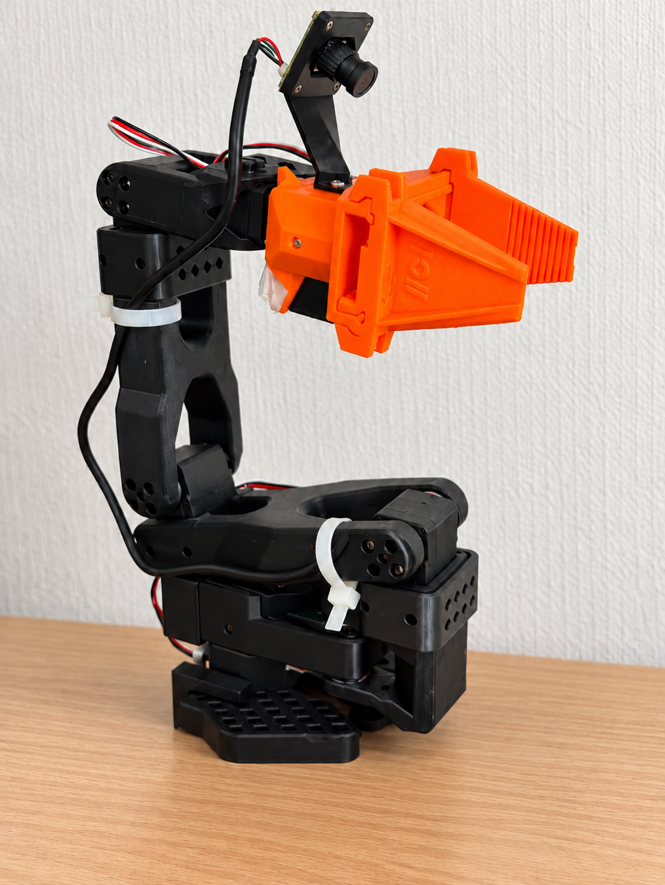

# SO-ARM101 robot description

This package defines the SO-ARM101 and NormaCore pgripper model.
It provides motor-calibration procedures and RViz launch files.

## Joints and calibration conventions

| Motor ID | Joint | Convention |
| --- | --- | --- |
| 1–4 | `shoulder_pan`, `shoulder_lift`, `elbow_flex`, `wrist_flex` | Tick 2048 maps to 0 rad. The body ranges are symmetric around zero. |
| 5 | `wrist_roll` | Tick 2048 maps to the visually upright jaw pose. Separate measurements provide asymmetric limits. |
| 6 | `gripper` | EEPROM closed position is tick 2048. ROS open position is 0 rad. Positive angles close the jaws. |

The two jaw joints are prismatic mimics of the `gripper` motor.
`gripper_frame_link` and `tool0` define the tool frames for IK.

## Build and inspect the model

From the workspace root, run:

```bash
pixi install
pixi run build
pixi run test
pixi run check
pixi run display
```

`pixi run display` starts the model and joint sliders.
It does not open a motor serial port.

For mock planning, run:

```bash
pixi run moveit-demo
```

The mock launch does not open the serial port.
The arm group contains five arm joints.
The gripper motor is a separate actuator.

The [MoveIt guide](../so_arm101_pgripper_moveit_config/README.md)
describes planning, approximate IK, and Servo.

## Calibrate the physical arm

> [!WARNING]
> Support the arm throughout calibration. Disabling torque can let the arm fall.
> Calibration can rewrite motor EEPROM.

The examples use the robot ID `lab_follower`.
The workspace Pixi tasks use `so_arm101_pgripper_follower`.
These IDs select different calibration files.

### Identify the serial device

Find the current port:

```bash
pixi run lerobot-find-port
```

Ping the example port:

```bash
pixi run ./install/feetech_ros2_driver/bin/demo ping /dev/ttyACM0
```

At the prompt, enter servo ID 1.
Continue only after `Ping success`.
Do not assume that an old `/dev/ttyACM0` assignment still identifies this robot.

### Run full calibration

Run the wrapper:

```bash
pixi run calibrate \
  --port /dev/ttyACM0 \
  --robot-id lab_follower \
  --calibration-dir config/hardware
```

At the first pose prompt:

1. Put shoulder pan, shoulder lift, elbow, wrist flex, and wrist roll at their physical middle positions.
2. Close the pgripper completely without an external load.
3. Press Enter.

During the sweep:

1. Move joints 1–4 slowly through their permitted travel.
2. Move the pgripper from fully closed to fully open.

LeRobot excludes wrist roll from this sweep.

LeRobot 0.6.1 initially centers at 2047.
The wrapper shifts EEPROM offsets and ranges by one tick.
It makes the body ranges symmetric around 2048.
It maps the measured gripper-open tick to 0 rad.

### Measure wrist-roll limits

After full calibration, run:

```bash
pixi run calibrate \
  --port /dev/ttyACM0 \
  --robot-id lab_follower \
  --calibration-dir config/hardware \
  --wrist-roll-only
```

1. Support the arm.
2. Place the jaws visually upright.
3. At the prompt, move wrist roll gently counterclockwise to its stop.
4. At the next prompt, move wrist roll gently clockwise to its stop.
5. Examine the proposed limits before the EEPROM-write confirmation.

The script keeps torque disabled and adds a 64-tick margin.
It writes motor 5 only after `WRITE_WRIST_EEPROM` confirmation.

If motor 5 EEPROM differs from the saved JSON calibration, the script refuses to start.

### Calibration files

The wrapper saves these files for the example ID:

```text
config/hardware/lab_follower.json
config/hardware/lab_follower.state.yaml
config/hardware/lab_follower.control.yaml
config/hardware/lab_follower.joint_limits.yaml
config/hardware/lab_follower.*.raw-lerobot.json
config/hardware/lab_follower.*.previous.json
```

| File | Purpose |
| --- | --- |
| `.json` | Aligned LeRobot calibration |
| `.state.yaml` | Read-only ROS mapping without EEPROM fields |
| `.control.yaml` | Motion configuration and EEPROM fields |
| `.joint_limits.yaml` | Calibrated joint limits |
| `.raw-lerobot.json` | Original LeRobot output |
| `.previous.json` | Previous aligned calibration, when present |

## Physical check 1: read-only RViz

Do not run LeRobot and the ROS driver at the same time.
Both require exclusive access to the serial bus.

For the workspace's `so_arm101_pgripper_follower` configuration, run:

```bash
pixi run real-rviz
```

For the `lab_follower` example, run these commands inside the Pixi environment:

```bash
source install/setup.bash
ros2 launch so_arm101_pgripper_description real.launch.py \
  port:=/dev/ttyACM0 \
  joint_config_file:=$PWD/config/hardware/lab_follower.state.yaml \
  joint_limits_file:=$PWD/config/hardware/lab_follower.joint_limits.yaml \
  read_only:=true
```

1. Support the arm.
2. Move each arm joint by hand.
3. Make sure that RViz follows the same direction.
4. Make sure that centered arm joints show 0 rad.
5. Open the gripper.
6. Make sure that `gripper` shows 0 rad.
7. Close the gripper by hand.
8. Make sure that the ROS gripper angle increases.

If a joint wraps, times out, or moves in the wrong direction, stop the procedure.
If the wrong joint responds, stop the procedure.

## Physical check 2: motor motion

> [!WARNING]
> Complete the read-only check before motor motion.
> Support the arm. Keep the power connector accessible.

Inside the Pixi environment, run:

```bash
source install/setup.bash
ros2 launch so_arm101_pgripper_description real.launch.py \
  port:=/dev/ttyACM0 \
  joint_config_file:=$PWD/config/hardware/lab_follower.control.yaml \
  joint_limits_file:=$PWD/config/hardware/lab_follower.joint_limits.yaml \
  read_only:=false \
  confirm_hardware:=MOVE_REAL_ARM
```

This starts the `/arm_controller/follow_joint_trajectory` interface.
The driver initializes commands from measured positions before it enables torque.

Begin with small, low-speed, single-joint goals inside the calibrated limits.

Software tests do not establish physical collision safety.
These physical checks assess joint behavior, not every possible collision.

## LeRobot compatibility

Use the same robot ID and calibration directory in LeRobot.

The existing example uses:

```bash
lerobot-teleoperate \
  --robot.type=so101_follower \
  --robot.port=/dev/ttyACM0 \
  --robot.id=lab_follower \
  --robot.calibration_dir=$PWD/config/hardware
```

This example specifies the follower.
A complete teleoperation setup also requires an input device and its configuration.

LeRobot uses degrees for arm observations and actions.
Its `gripper.pos` range is 0–100.
The WH148 leader is not implemented.

## Model sources

The body geometry and frames come from TheRobotStudio's SO-ARM101 description.
The pgripper geometry and mimic kinematics come from NormaCore's ElRobot URDF.

The configured pgripper mount is:

```text
xyz="0 0 0"
rpy="-pi/2 0 -pi/2"
```

[ATTRIBUTION.md](ATTRIBUTION.md) records source revisions, modifications, and licenses.

## Gripper camera model


*Camera bracket attached to the gripper body.*

The description defines these links:

- `camera_mount_link`
- `camera_link`
- `camera_optical_frame`.

Fixed joints connect them to the gripper body.

The mount uses `CameraMount_square_27mm.stl`.
The camera body and lens use approximate primitive geometry.
The optical-center offset is nominal, not a hand–eye calibration result.

MoveIt excludes two intentional assembly contacts:

- `pgripper_base_link` with `camera_mount_link`
- `camera_mount_link` with `camera_link`.

Other camera collision checks remain enabled.

The [camera package](../so_arm101_pgripper_cameras/README.md)
provides capture and intrinsic calibration.
Intrinsic calibration does not determine the camera-to-gripper transform.
Physical optical-frame alignment remains unverified.
